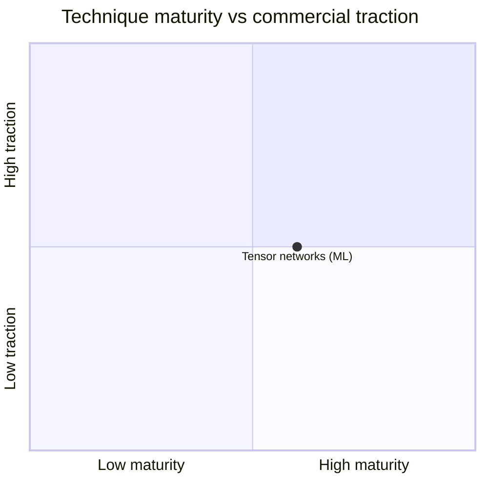

# Visuals

Add a visual only when it explains something faster than prose. Every visual
needs a caption and the source IDs it draws on.

## Pick the simplest format that works

| Need | Use |
|---|---|
| Compare items on several attributes | **Markdown table** |
| Events over time | Mermaid `timeline` or `gantt` |
| Positioning (e.g. maturity × impact) | Mermaid `quadrantChart` |
| Process, flow, decision logic | Mermaid `flowchart` |
| Architecture, components, integrations | Mermaid `flowchart` with subgraphs, or `C4Context` |
| Taxonomy or concept breakdown | Mermaid `mindmap` |
| Quantitative data (trends, shares, distributions) | Chart: see "Richer graphics" below |

## Mermaid

Put Mermaid in a fenced block in the markdown output so it renders on GitHub:

````markdown

*Figure 1: Positions are analyst judgement based on [S04][S09][S12].*
````

Keep labels short. Ten or fewer nodes per diagram reads best. Split large
diagrams.

## Richer graphics

When Mermaid cannot show it well (real numeric charts, dense comparisons,
interactive views):

- Save the file to `projects/<slug>/outputs/figures/` as either
  - a **PNG/SVG** produced by a small script (e.g. Python + matplotlib), with
    the script saved next to it as `figure-name.py` and its data inline or as
    a `.csv`, or
  - a **self-contained HTML** page (no external data calls).
- Embed or link it from the brief or report:
  ``.
- Use only numbers that appear in `findings.md` with source IDs. Never
  plot made-up or "illustrative" figures without labelling them clearly.
