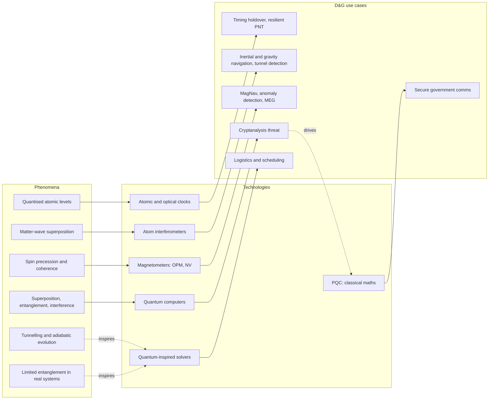

# Quantum phenomena to defence and government use cases: Deep-dive report

*10 October 2026 · Sources: 101 logged, 87 cited · Overall confidence: medium to high for the phenomenon map and sensing chains; medium for frontier phenomena; low for timelines*

## Executive summary

Defence and government quantum use today rests on a small set of well-understood phenomena: quantised atomic energy levels, matter-wave superposition and spin precession. These drive clocks, atom interferometers and magnetometers that are now in field trials [S30 Table I][S37][S39][S41]. Entanglement, central to quantum computing and QKD [S29], appears in defence sensing only in lab demonstrations and in quantum radar, which official US advice rejects [S66][S45 §VI][S93]. Two of the three priority areas from the prior scan, PQC and quantum-inspired methods, run on classical hardware. PQC is a defence against what quantum computers will eventually do [S71][S75]. Quantum-inspired solvers borrow quantum mathematics without quantum hardware [S83][S84][S79].

- Phenomena fall into three bands: deployed for decades (MRI, transistors, lasers, atomic clocks), field-trialled for defence now (compact clocks, cold-atom inertial and gravity sensors, optically pumped magnetometers) and lab or theory with asserted applications (topological qubits, time crystals, quantum batteries).
- Sensing is held back by engineering. DARPA calls quantum sensors "notoriously fragile in real-world environments", and no UK quantum navigation trial has published performance data [S42][S48].
- Classical methods keep matching quantum claims. Tensor networks reproduced IBM's 2023 "utility" experiment, and a July 2026 Siemens study found only a quantum-inspired annealer handled industry-scale scheduling [S79][S80][S110].
- Press releases routinely go further than the peer-reviewed papers (Microsoft's Majorana work, Aalto's time crystals), and several headline results have been retracted or failed to reproduce [S50][S51][S56][S57][S64][S65][S68].

## Context & scope

This report supports a Deloitte whitepaper on quantum in defence and government. It traces quantum phenomena to the technologies they enable and then to use cases, and rates how close each link is to reality. The user's prior market scan [S01] set the client priorities: PQC, quantum sensing and quantum-inspired methods. This report does not repeat that scan's contract and funding detail.

Physics research is global; programmes and use cases are UK and Europe first, then the US and NATO. Maturity evidence is weighted to 2023–2026. Older sources are used for definitions and anchors, and flagged where they carry maturity claims.

Section 1 explains the chain and its three bands. Section 2 is the phenomenon map for shortlisting. Sections 3 to 6 trace each family of technologies. Section 7 maps technologies to use cases.

## 1. The chain and how to read it

A quantum phenomenon is a behaviour of matter or light that classical physics cannot explain, such as superposition, tunnelling or entanglement. Dowling and Milburn, who framed the "second quantum revolution", list six principles that quantum technology exploits: quantisation, uncertainty, superposition, tunnelling, entanglement and decoherence [S10 "Quantum principles"]. The first revolution used these rules to explain and build semiconductors and lasers; the second engineers quantum states on purpose [S10 abstract, intro]. UK government uses the same split: first-generation technologies such as lasers and MRI, and second-generation ones based on "the ability to generate, detect and control quantum states" [S13].

Governments do not organise quantum by phenomenon. The EU groups it into computing and simulation, sensing and communication; NATO into sensing, imaging, PNT, communications, computing and simulation [S15 fn.1][S14]. The map in section 2 therefore had to be assembled from academic and Nobel sources and then matched to these policy buckets.

*Figure 1: The three priority areas in the chain. Solid lines are physical dependencies; dotted lines mark classical technologies that respond to or borrow from quantum ones. Built from [S30][S37][S31][S34][S71][S74][S83][S84][S79].*

Figure 1 shows that PQC and quantum-inspired methods enter the chain at different points from sensing. Sensing uses a phenomenon directly. PQC exists because of a technology (a future cryptographically relevant quantum computer); it uses classical mathematics: module lattices for ML-KEM and ML-DSA, hashes for SLH-DSA, error-correcting codes for HQC [S71][S72]. Quantum-inspired solvers take mathematical ideas from tunnelling, adiabatic evolution and entanglement structure and run them on CMOS, FPGA or GPU hardware [S83][S84][S79].

## 2. The phenomenon map

The table below is the broad list for shortlisting. "Band" is this report's grouping: **A** deployed for decades, **B** field-trialled for defence or government now, **C** lab or theory with asserted applications. A phenomenon can sit in several bands through different technologies.

| Phenomenon | Plain English | Established technology | Emerging technology (maturity) | D&G link | Band | Sources |
|---|---|---|---|---|---|---|
| Nuclear magnetic resonance | Nuclei in a magnet absorb and re-emit radio waves at a set frequency | MRI: about 22,000 scanners by 2002 | Quantum-enhanced MRI pilot (prototype) | Health | A | [S20][S94 §2.2.3] |
| Quantised energy levels in crystals | Electrons in solids can hold only certain energies | Transistors, chips, lasers, solar cells | Quantum-dot single-photon sources (early commercial) | Electronics base; photonic quantum tech | A | [S16 Ch.1][S18][S60] |
| Quantum electronics (maser-laser principle) | Atoms emit light in step with incoming light | Laser, maser | Lasers as the control layer for cold-atom sensors | All optical quantum sensors | A | [S26][S13] |
| Tunnelling | Particles pass through barriers that classically block them | Tunnel diode, scanning tunnelling microscope | Superconducting qubits via macroscopic tunnelling (prototype) | Computing | A, B | [S19][S23][S18] |
| Spin-dependent tunnelling and magnetoresistance | Electrical resistance depends on electron spin alignment | Hard-disk read heads, MRAM | Skyrmion memory and logic (lab demo) | Radiation-tolerant memory (lab-tested) | A, C | [S21][S53][S69] |
| Josephson effect, superconductivity | Supercurrent crosses a thin barrier; voltage locks to frequency | Voltage standard, SQUID magnetometers, MRI magnets | Superconducting quantum computers | Metrology; computing | A | [S27][S30 §III.G.1][S13] |
| Quantum Hall effect (topological) | Resistance comes in exact steps set by fundamental constants | Resistance standard; 2019 SI redefinition | Topological electronics and qubits (theory to contested lab demo) | None evidenced | A, C | [S27][S25][S50][S52] |
| Photoelectric effect | Light knocks electrons free and makes a current | CCD image sensors, solar cells | Single-photon detectors for QKD and imaging | Imaging | A | [S22][S10] |
| Atomic transitions | Atoms absorb and emit at fixed frequencies | Caesium clocks, SI second, satnav timing | Compact cold-atom and optical clocks (field trial) | Timing holdover, resilient PNT, national timing | A, B | [S16][S37][S39][S106] |
| Matter-wave superposition and interference | Atoms split into two paths and recombine; the phase measures motion or gravity | None | Atom-interferometer gravimeters, accelerometers, gyroscopes (field trial) | Inertial navigation, gravity navigation, tunnel detection | B | [S31][S32][S33][S41] |
| Spin polarisation and precession | Light-aligned atomic spins precess in a magnetic field | None | Optically pumped magnetometers (field trial) | MagNav, anomaly detection, wearable brain scanners | B | [S30 §III.A.1][S34][S107] |
| Spin coherence in solid-state defects | Electron spins in diamond keep phase at room temperature | None | NV-diamond magnetometers (prototype) | MagNav (asserted) | B, C | [S12][S35] |
| Rydberg atoms | Highly excited atoms with huge electric dipoles | None | RF electric-field receivers (lab demo to prototype) | Spectrum awareness, EW (aspirational) | C | [S44][S49] |
| Squeezing | Quantum noise moved out of the variable being measured | Gravitational-wave detectors (LIGO, GEO600) | Spin-squeezed clocks (lab demo) | None evidenced | A (science), C | [S46][S12] |
| Entanglement | Linked particles whose results correlate beyond classical limits | None | QKD, quantum networks, entanglement-enhanced sensing (lab demo to niche product) | Secure comms (contested); sensing (lab) | C | [S29][S66][S75] |
| No-cloning | Unknown quantum states cannot be copied | None | Security basis of QKD | Secure comms (contested) | C | [S29][S75] |
| Measurement randomness | Quantum measurement outcomes are intrinsically random | None | QRNG (product; assurance research needed) | Key generation (NCSC: classical RNGs suffice) | B | [S12][S75] |
| Superposition, entanglement, interference in qubits | Many states processed at once and combined by interference | None | Gate-based quantum computers (prototype) | Cryptanalysis threat; materials and chemistry | C | [S74][S70][S93] |
| Bose–Einstein condensation | Atoms cooled into one shared quantum state | None | Micro-BEC sensors (lab demo) | None evidenced | C | [S12][S10] |
| Polariton condensation | Hybrid light-matter particles condense at room temperature | None | Polariton lasers (lab demo to prototype) | None evidenced | C | [S59] |
| Superabsorption (collective light absorption) | Many molecules absorb energy faster together than alone | None | "Quantum batteries" (not yet demonstrated) | None evidenced | C | [S54] |
| Time-crystalline order | A system that repeats in time without being driven at that rhythm | None | Proposed memory and sensing uses (theory) | None evidenced | C | [S55][S57][S56] |
| Moiré superconductivity | Twisted graphene layers superconduct at very low electron density | None | Single-photon detectors at 1550 nm (lab demo) | Infrared sensing (inferred) | C | [S58] |
| Radical-pair spin chemistry | Light-made electron-spin pairs in proteins respond to magnetic fields | None | Magneto-sensitive fluorescent proteins (lab demo) | "Quantum compass" (speculative) | C | [S62][S63] |
| Strong light–matter coupling in chemistry | Cavities modify molecular vibrations and maybe reaction rates | None | Cavity-controlled chemistry (disputed) | None (US defence lab result negative) | C | [S64][S65] |
| Optomechanical quantum states | Mechanical oscillators behave quantum-mechanically | None | Entanglement-enhanced force sensors (lab demo) | Navigation (author-asserted; ONR, DARPA funded) | C | [S66] |

*Table 1: Phenomenon map. Band assignment is analyst judgement based on the maturity evidence cited in each row and in sections 3 to 6. Calling the laser's mechanism "stimulated emission" or GMR a "quantum" effect is explanatory gloss; the cited Nobel sources use "quantum electronics" and do not label GMR quantum [S26][S21].*

Two anchors the user suggested need care. Flash memory as a tunnelling product is plausible but `[unsupported]` in this evidence set. The usual phrase "hyperfine transition" for caesium clocks is not used by the source, which says "caesium microwave transition" [S16].

## 3. Sensing, timing and navigation

Quantum sensing works at three levels: using quantised energy levels, using coherence (superposition), and using entanglement to beat classical noise limits [S30 §II]. Every defence sensor now in field trials works at the first two levels [S30 Table I][S41]. *Analysis:* the whitepaper should say this early, so readers do not assume quantum sensing depends on entanglement.

| Chain | Best evidence | Maturity | Use case | Evidence status |
|---|---|---|---|---|
| Atomic transitions → optical clock | Three 35 L clocks, 20 days at sea, under 300 ps/day error [S37] | Field trial | GNSS-independent timing holdover | Evidenced, peer-reviewed (US) |
| Atomic transitions → cold-atom clock | Dstl unattended trials; 2027 military trial planned [S39]. Aquark AQlock three days on HMS Pursuer [S38] | Field trial | Military PNT; submarine and UUV navigation | Trial evidenced; no UK performance data public |
| Atomic transitions → national time scale | £180m National Timing Centre (Mar 2026) [S106] | Product, scaling | Telecoms, finance, transport, emergency services | Funded programme |
| Matter-wave interference → gravity gradiometer | 2 m tunnel found, SNR 8, 0.5 m resolution, static survey [S31] | Field trial (static) | Tunnel and buried-utility detection | Evidenced (UK, peer-reviewed); moving survey not shown |
| Matter-wave interference → inertial sensors | RJ100 flight at Boscombe Down, May 2024 [S48]; simulation shows drift halved, not removed [S32] | Field trial | Aircraft and ship navigation | Flight happened; benefit unquantified |
| Spin precession → OPM MagNav | Vendor claims up to 46× lower error than strategic-grade INS, best 22 m [S34] | Field trial | Aircraft navigation without GNSS | Vendor preprint only |
| Spin precession → OPM-MEG | Research use; clinical approval hoped for 2027 [S107] | Prototype | Paediatric epilepsy surgery | Research evidenced; clinical pending |
| Spin coherence → NV magnetometer | Moving-van test; 140–210 nT/√Hz per axis at low frequency [S35] | Prototype | MagNav (asserted) | Preprint |
| Rydberg atoms → RF receiver | Lab-scale only, per DARPA [S49]; instantaneous bandwidth under 10 MHz [S44] | Lab demo → prototype | Spectrum awareness, EW | Aspirational |
| Squeezed light → interferometer | LIGO noise down 5.8 dB, detection rate up 65% [S46] | Deployed (science) | Defence lidar or imaging | Not sourced for defence |
| Entanglement → quantum radar | Advantage only at powers 15–20 orders of magnitude below radar practice [S45 §VI] | Theory / lab | Counter-stealth | Rejected by US Defense Science Board [S93] |

*Table 2: Sensing chains with maturity. Maturity tags follow the cited sources.*

**Timing is the most mature link.** The strongest peer-reviewed result is a US optical-clock trial at sea [S37]. In the UK, Dstl has run unattended clock trials and plans a broader military trial in 2027 [S39]. The civil counterpart is already funded at scale: £180m for a National Timing Centre that distributes atomic-clock time by fibre, satellite and radio [S106]. The economic case is documented: a 24-hour UK-wide GNSS outage is estimated to cost £1,424m [S105]. The 2025 Strategic Defence Review uses an older "£1bn a day" figure sourced to 2018 [S95 fn 88].

**Cold-atom sensors reduce inertial drift.** A UK simulation found cold-atom sensors would roughly halve the drift of an aviation-grade inertial system, but not remove it [S32 §5–6]. Gravity gradiometry found a buried tunnel in a static survey [S31], and the US Navy and ONR are maturing an atomic accelerometer for gravity-aided navigation [S41]. No gravity-map navigation result was found.

**Magnetic navigation has the boldest claims and the thinnest independent evidence.** Q-CTRL's airborne result is vendor-authored and not peer reviewed. Its CEO is quoted at 94× while the preprint says 46× [S34][S47]. Q-CTRL's CEO is also quoted saying aircraft magnetic noise is 100 to 1,000 times the anomaly signal [S47]. If so, software denoising does much of the work.

**Engineering is the constraint.** DARPA's RoQS programme exists because quantum sensors are "notoriously fragile in real-world environments" [S42]. CSIS points to platform noise, vibration and thermal drift [S99]. The best lab optical clocks reach 10⁻¹⁸ fractional inaccuracy, but transportable versions have been held back by size, environmental sensitivity and cost [S37].

## 4. Computing, cryptography and PQC

**The threat comes from superposition, entanglement and interference working together in a fault-tolerant quantum computer.** Such a machine could break RSA and elliptic-curve public-key cryptography [S73][S74]. None exists today. NCSC describes current machines as limited with relatively high error rates, and says arrival is hard to predict [S74]. The resource estimate has fallen sharply: Gidney's 2025 preprint puts RSA-2048 at under one million noisy qubits in under a week, against 20 million in his 2019 estimate under the same hardware assumptions [S70]. Harvest-now-decrypt-later collection makes the future machine a current risk for long-lived data [S74].

**PQC is the response, and it is classical.** NIST finalised FIPS 203, 204 and 205 on 13 August 2024 and picked HQC as a backup on 11 March 2025, with a final standard expected in 2027 [S71][S72]. NCSC recommends ML-KEM-768 and ML-DSA-65, and sets milestones of discovery and planning by 2028, priority migrations by 2031 and complete migration by 2035 [S73][S74]. Symmetric cryptography with keys of at least 128 bits is "not significantly impacted" [S74]. Grover's algorithm gives at most a quadratic speedup [S81].

**QKD is the quantum-phenomenon route to secure communication, and the UK rejects it for government use.** QKD uses measurement disturbance and the no-cloning theorem to detect eavesdropping, but provides no authentication [S75][S29]. NCSC states it "will not support the use of QKD for government or military applications" [S75]. French, German, Dutch and Swedish agencies judge it niche [S76], and the US Defense Science Board judged it not deployable for mission use [S93]. NATO leaves room for it "in the future" [S14], and the European Commission calls it "ultra-secure" [S94 §2.4]. For UK readers the position of NCSC, as national technical authority, should lead.

**Timelines remain contested.** RUSI suggests 1,000 to 10,000-qubit machines could enable "meaningful cryptanalysis of specific classical encryption schemes" within about ten years [S100]. Its author co-founded a company named in the report. DOD judged quantum computers at least ten years away in July 2025 [S93].

**Computing applications beyond cryptanalysis are exploratory in defence.** Singapore's MINDEF agencies are evaluating IBM quantum optimisation for mission planning and logistics; the press release says it "could eventually help" [S89]. Dstl's most recent public assessment of quantum computing dates from 2020 [S87].

## 5. Quantum-inspired methods

Quantum-inspired methods are classical algorithms or chips that borrow mathematics from quantum physics. Four families appear in the evidence:

| Method | Quantum idea borrowed | Hardware | Evidence |
|---|---|---|---|
| Simulated bifurcation (Toshiba) | Adiabatic quantum optimisation in nonlinear oscillators | FPGA, GPU | Authors report a 2,000-node MAX-CUT in 0.5 ms, about 10× faster than a coherent Ising machine [S83] |
| Digital Annealer (Fujitsu) | Annealing (enhanced simulated annealing) | CMOS | About 100× speedups on dense problems against single-core baselines; none on sparse ones [S84] |
| Tensor networks | Limited entanglement in physical states | CPU, GPU | Reproduced IBM's 127-qubit experiment classically, one more accurately than the quantum processor [S79][S80] |
| Dequantised algorithms | Sampling in place of superposition | CPU | Removed the exponential speedup of the leading quantum recommendation algorithm [S77] |

*Table 3: Quantum-inspired families. "Quantum idea borrowed" follows the authors' own descriptions [S83][S84][S77] and, for tensor networks, [S85][S79].*

**The best recent industrial evidence favours the inspired hardware.** A July 2026 Siemens study ran a real job-shop scheduling problem on IBM gate-based hardware, a D-Wave annealer and the Fujitsu Digital Annealer [S110]. IBM processors "still solve only toy instances"; D-Wave did better only with a compact formulation. The Digital Annealer handled industry-scale instances and beat classical heuristics on solution quality [S110 §VIII.B]. Two caveats apply: the paper is a preprint, and the industry-scale baseline was heuristics, not a leading commercial solver.

**Classical methods keep catching quantum claims.** IBM's 2023 experiment was reproduced classically within weeks [S78][S79][S80]. D-Wave's 2025 "beyond-classical" result in Science is challenged by a tensor-network preprint [S85][S86]. A 46-author review concludes "more tools are needed to realize a quantum advantage in optimization" [S81]. The QOBLIB benchmark library now supplies classical baselines for fair comparison [S82].

## 6. Frontier phenomena: closer than expected, or theory crafting

The user asked which emerging phenomena are closer than they look and which are interest-building. The table sets the strongest application claim against the evidence.

| Phenomenon | Claim | Who claims it | Evidence | Read |
|---|---|---|---|---|
| Spin-dependent tunnelling | Radiation-tolerant memory for space and nuclear | Authors of a 2019 study [S69] | MRAM is a product [S53]; radiation tests at device level only [S69] | Closer than expected |
| Quantum-dot photon sources | Photonic quantum technology | Review authors [S60] | Early commercial; telecom-band dots fall short [S60] | Closer than expected (comms only) |
| Moiré superconductivity | Mid-infrared and THz single-photon detection | Authors [S58] | One non-optimised device at 1550 nm and tens of millikelvin [S58] | Plausible, early |
| Optomechanical entanglement | Better inertial navigation | Authors, ONR and DARPA funded [S66] | 25% sensitivity-bandwidth gain in lab [S66] | Plausible, early |
| Topological states (Majorana) | Scalable fault-tolerant qubits | Microsoft press release [S51] | Paper says data "do not, by themselves, determine" topology [S50]; critique calls findings "not reliable" [S52] | Contested |
| Polariton condensates | Optical computing, qubits | Review authors [S59] | Room-temperature polariton lasing; computing "promising" [S59] | Lab stage |
| Time crystals | Quantum-computer memory | Aalto press release [S56] | Review: applications "are limited" [S57] | Theory crafting |
| Superabsorption | Quantum batteries | Early papers [S54] | Field review: battery "yet to be demonstrated" [S54] | Theory crafting |
| Radical-pair magnetoreception | Bio-inspired quantum compass | Popular framing | Bird protein sensitivity shown in vitro only [S62]; lab biosensing proteins [S63] | Speculative for navigation |
| Photosynthetic coherence | Quantum-enhanced energy harvesting | Earlier literature | Coherences "too short lived to have any functional significance" [S61] | Not supported |
| Cavity chemistry | Reaction control by light–matter coupling | Earlier literature | Failed replication [S64]; US Naval Research Laboratory retracted its own effect [S65] | Disputed |
| Room-temperature superconductivity | Lossless power, cheap magnets | LK-99 and Dias group | LK-99 is an insulator [S67]; Dias paper retracted [S68] | Refuted |

*Table 4: Claims against evidence for frontier phenomena. "Read" is analyst judgement based on the cited evidence.*

Two patterns run through the table. Press framing goes further than the peer-reviewed paper (Microsoft [S50][S51], Aalto [S56][S57]). Headline results fail to reproduce or are retracted (Delft Majorana [S51], cavity chemistry [S64][S65], room-temperature superconductivity [S68]).

## 7. Technology to use case: defence and government

| Technology | Use case | Owner or programme | Maturity per source | Sources |
|---|---|---|---|---|
| Compact atomic and optical clocks | Timing holdover; submarine and UUV navigation | Dstl, Royal Navy, Army | Field trial; 2027 follow-on | [S39][S37] |
| National atomic time scale | Resilient time for telecoms, finance, transport | DSIT, NPL | Funded, £180m | [S106][S105] |
| Quantum navigation system | GNSS-independent navigation on aircraft | UK Mission 4 | Target for 2030 | [S40] |
| Networked quantum sensors | Find objects in challenging environments; underground sensing; RF sensing | UK Mission 5 | Target for 2030 | [S90] |
| OPM brain scanners | Paediatric surgery planning; NHS diagnosis | UK Mission 3; NHS | Research; approval hoped for 2027 | [S90][S107] |
| Inertial, gravity and magnetic sensors | Air, sea and space navigation; magnetic anomaly detection | US DIU TQS | Field tests, no results published | [S41] |
| Quantum PNT sensors | GNSS-denied navigation at sea | NATO QUESTOR trials | Sea trials 2026–27 | [S92] |
| Quantum IMU, free-space QKD | C4ISR, GNSS-denied positioning | EDA QuantaQuest | Building block and demo | [S104] |
| Quantum gravimeters and inertial prototypes | Underground structures, Galileo upgrades | European Commission | Plans; defence use asserted | [S94 §2.4][S15 §2.2.3] |
| Space gravity gradiometer | Water, resources, national security mapping | NASA JPL | Pre-flight prototype | [S109] |
| Quantum sensing (general) | Alternative PNT, underground structures, nuclear materials, EW | US DSB via CRS | "Poised for mission use" | [S93] |
| PQC | Protecting government and alliance cryptography | NCSC, NIST, NATO | Standards final; migration to 2035 | [S73][S71][S14] |
| QKD | Secure government communications | NCSC; DSB | Rejected for UK and US mission use | [S75][S93] |
| Quantum radar | Counter-stealth | DSB; CSIS | "Will not provide upgraded capability" | [S93][S99] |
| Quantum and quantum-inspired optimisation | Mission planning, logistics, scheduling | Singapore MINDEF; Dstl (2020) | Evaluation; stale forecasts | [S89][S87][S110] |

*Table 5: Use-case matrix. Maturity as judged by each source.*

Across official sources, sensing for navigation and timing is consistently ranked the nearest defence use. CRS reports the Defense Science Board view that it is "the most mature military application" and "poised for mission use", while noting quantum technology "has not yet reached maturity for most applications" [S93]. CSIS gives a grounded version of the near-term payoff: "better cueing, more resilient navigation, and more persistent wide-area search" [S99]. NATO's roadmap commits to a use-case repository and Quantum Assessment Criteria by Q2 2027 [S92], which may become the allied reference for this mapping.

## Analysis & implications

*This section is the author's interpretation, tied to finding IDs in `findings.md`.*

**Use the three bands as the shortlisting rule.** Band B (field-trialled now) contains three phenomena: atomic transitions, matter-wave interference and spin precession (F26–F34). They carry the defence story today. Band A gives the whitepaper its credibility anchors: MRI, the transistor, the laser and the caesium clock show that "quantum" has been delivering for decades (F07–F15). Band C is where to show judgement, by naming what is not ready (F64–F75).

**Lead with "the old quantum is doing the work".** Defence sensors in trials rely on quantised levels and coherence, not entanglement (F16, F60). It matches the evidence and avoids overstating what entanglement does today.

**Frame PQC and quantum-inspired as classical answers to quantum ideas.** PQC is a programme-delivery problem with a clock set by NCSC milestones (F97–F100). Quantum-inspired methods are the deployable near-term computing offer (F50–F54, F63, F101). Neither needs quantum hardware, which makes them easier for clients to adopt and easier to evidence.

**Recommend benchmarking before buying.** Classical and inspired methods have repeatedly matched quantum claims (F52–F54, F63). For defence optimisation, a pilot should compare against quantum-inspired and best classical solvers before committing to quantum hardware.

**Treat 2030 targets as targets.** Dstl's 2020 forecast of an in-service quantum-annealer capability by 2025 did not visibly happen (F76). The UK has no published performance data from its quantum navigation flight (F29), and OPM-MEG is still awaiting approval (F37). The UK missions (F77–F79) read better as ambitions than forecasts.

**Offer a hype test.** Two questions sort most claims in this report: has anyone outside the originating group reproduced it, and has it left the lab? Table 4 applies them.

## Evidence quality & gaps

**Strong:** first-wave anchors (Nobel and NIST sources), PQC standards and NCSC policy, the quantum radar critique, the classical rebuttals of quantum computing claims, and UK policy targets. All rest on T1 sources.

**Mixed:**
- Sensing field evidence. One peer-reviewed US clock trial [S37] and one UK static gravity survey [S31] are strong. UK trials are reported without data [S38][S39][S48], and MagNav results are vendor-only [S34].
- Several frontier sources are preprints or reviews read via arXiv (S53, S54, S57, S58, S60).

**Thin or missing:**
- No post-2020 Dstl source on quantum computing.
- No T1/T2 source on SQUIDs in defence, squeezed-light lidar for defence, gravity-map navigation results or Rydberg field results.
- Flash memory as a tunnelling anchor is unsourced.
- The Defense Science Board study quoted by CRS was not opened, and its date is unverified [S93].
- Royal Navy pages were blocked, so trials there rest on vendor and press reports.
- Topological insulators, topological photonics, hBN emitters and quantum simulation of defence materials were not covered.

**What would change the conclusions:**
- Published performance data from UK or NATO navigation trials.
- An independent replication of MagNav results.
- A peer-reviewed quantum optimisation advantage on an industrial instance.
- A resolution of the Majorana dispute.

## Open questions / next steps

- Shortlist: which Band B and Band C phenomena should the whitepaper feature? A second pass can go deeper on the shortlist.
- Should the paper adopt the team's Inspired / Utility / Advantage framing for sensing [S01]? Table 2's maturity tags offer an alternative based on deployment stage.
- Close the gaps above, starting with Dstl's current quantum computing position and published trial data.
- Check whether NATO's use-case repository (due mid-2027) and Quantum Assessment Criteria [S92] can serve as the paper's external reference frame.

## Sources

| ID | Source | Tier | Date |
|---|---|---|---|
| S01 | Quantum in Defence & Government (draft for team discussion) (``inbox/Quantum_in_Defence__Government.html``), User's team; compiled from six research streams and a verifi | internal | 2026-09-30 |
| S10 | [Quantum Technology: The Second Quantum Revolution](https://arxiv.org/abs/quant-ph/0206091), Jonathan P. Dowling, Gerard J. Milburn | T2 | 2002-06-13 |
| S12 | [The European Quantum Technologies Roadmap](https://arxiv.org/abs/1712.03773), A. Acín, I. Bloch, H. Buhrman, T. Calarco, … F. K. Wilhelm | T2 | 2017-12-11 |
| S13 | [National Quantum Strategy (accessible webpage)](https://www.gov.uk/government/publications/national-quantum-strategy/national-quantum-strategy-accessible-webpage), UK Department for Science, Innovation and Technology | T1 | 2023-03-15 |
| S14 | [Summary of NATO's Quantum Technologies Strategy](https://www.nato.int/cps/en/natohq/official_texts_221777.htm), NATO | T1 | 2024-01-16 |
| S15 | [Quantum Europe in a changing world (Quantum Europe Strategy, COM(2025) 363)](https://digital-strategy.ec.europa.eu/en/library/quantum-europe-strategy), European Commission | T1 | 2025-07-02 |
| S16 | [The Quantum Age: technological opportunities (Blackett Review)](https://assets.publishing.service.gov.uk/media/5a81828c40f0b62302697b29/gs-16-18-quantum-technologies-report.pdf), UK Government Office for Science | T1 | 2016 |
| S18 | [Press release: Nobel Prize in Physics 2025](https://www.nobelprize.org/prizes/physics/2025/press-release/), Royal Swedish Academy of Sciences | T1 | 2025-10-07 |
| S19 | [Press release: The 1973 Nobel Prize in Physics](https://www.nobelprize.org/prizes/physics/1973/press-release/), Royal Swedish Academy of Sciences | T1 | 1973-10-23 |
| S20 | [Press release: The Nobel Prize in Physiology or Medicine 2003](https://www.nobelprize.org/prizes/medicine/2003/press-release/), Nobel Assembly at Karolinska Institutet | T1 | 2003-10-06 |
| S21 | [Press release: The Nobel Prize in Physics 2007](https://www.nobelprize.org/prizes/physics/2007/press-release/), Royal Swedish Academy of Sciences | T1 | 2007-10-09 |
| S22 | [Press release: The Nobel Prize in Physics 2009](https://www.nobelprize.org/prizes/physics/2009/press-release/), Royal Swedish Academy of Sciences | T1 | 2009-10-06 |
| S23 | [Press release: The 1986 Nobel Prize in Physics](https://www.nobelprize.org/prizes/physics/1986/press-release/), Royal Swedish Academy of Sciences | T1 | 1986-10-15 |
| S25 | [Press release: The Nobel Prize in Physics 2016](https://www.nobelprize.org/prizes/physics/2016/press-release/), Royal Swedish Academy of Sciences | T1 | 2016-10-04 |
| S26 | [The Nobel Prize in Physics 1964 – Summary](https://www.nobelprize.org/prizes/physics/1964/summary/), nobelprize.org | T1 | undated |
| S27 | [Ampere: The Quantum Metrology Triangle (NIST SI Redefinition)](https://www.nist.gov/si-redefinition/ampere/ampere-quantum-metrology-triangle), NIST | T1 | created |
| S29 | [Scientific Background on the Nobel Prize in Physics 2022](https://www.nobelprize.org/uploads/2026/05/advanced-physicsprize-2022-5.pdf), The Nobel Committee for Physics | T1 | 2022-10-04 |
| S30 | [Quantum sensing (Degen, Reinhard & Cappellaro)](https://arxiv.org/abs/1611.02427), Reviews of Modern Physics | T1 | 2017 |
| S31 | [Quantum sensing for gravity cartography (Stray et al.)](https://www.nature.com/articles/s41586-021-04315-3), Nature 602, 590–594 | T1 | 2022-02-23 |
| S32 | [Cold atom inertial sensors for navigation applications (Wright et al.)](https://www.frontiersin.org/journals/physics/articles/10.3389/fphy.2022.994459/full), Frontiers in Physics 10 | T1 | 2022-10-03 |
| S33 | [Tracking the vector acceleration with a hybrid quantum accelerometer triad (Templier et al.)](https://arxiv.org/abs/2209.13209), S. Templier, P. Cheiney, …, P. Bouyer, B. Battelier, B. Barr | T2 | 2022-09-27 |
| S34 | [Quantum-assured magnetic navigation achieves positioning accuracy better than a strategic-grade INS in airborne and ground-based field trials (Muradoglu et al., Q-CTRL)](https://arxiv.org/abs/2504.08167), arXiv | T2 | 2025-04-10 |
| S35 | [On the Road with a Diamond Magnetometer (Graham et al.)](https://arxiv.org/abs/2401.16090), arXiv | T2 | 2024-01-29 |
| S37 | [Optical clocks at sea (Roslund et al.)](https://www.nature.com/articles/s41586-024-07225-2), Nature 628 | T1 | 2024 |
| S38 | [Aquark Technologies and the Royal Navy return to sea for world-first trial of cold atom-based atomic clock](https://thequantuminsider.com/2025/06/18/aquark-technologies-and-the-royal-navy-return-to-sea-for-world-first-trial-of-cold-atom-based-atomic-clock/), The Quantum Insider | T3 | 2025-06-18 |
| S39 | [Trial speeds up next generation of atomic clocks (Dstl)](https://www.gov.uk/government/news/trial-speeds-up-next-generation-of-atomic-clocks), Defence Science and Technology Laboratory | T1 | 2026-02-18 |
| S40 | [National Quantum Strategy Missions (DSIT)](https://www.gov.uk/government/publications/national-quantum-strategy/national-quantum-strategy-missions), Department for Science, Innovation & Technology, GOV.UK | T1 | 2023 |
| S41 | [DIU's TQS field testing to begin across five critical areas](https://www.diu.mil/latest/dius-transition-of-quantum-sensing-tqs-field-testing-to-begin-across-five), Defense Innovation Unit | T1 | 2025-03-12 |
| S42 | [From fragile to field-ready: RoQS program launches first phase (DARPA)](https://www.darpa.mil/news/2025/roqs-launches-first-phase), DARPA | T1 | 2025-08-27 |
| S44 | [Rydberg Atomic Receiver: Next Frontier of Wireless Communications (Cui, Zeng & Huang)](https://arxiv.org/abs/2412.12485), arXiv; accepted by IEEE Communications Magazine | T2 | 2024-12-17 |
| S45 | [Detecting a target with quantum entanglement (Sorelli, Treps, Grosshans & Boust)](https://arxiv.org/abs/2005.07116), arXiv; review written for radar engineers | T2 | 2020-05-14 |
| S46 | [Broadband quantum enhancement of the LIGO detectors with frequency-dependent squeezing (LIGO O4 Detector Collaboration)](https://research.birmingham.ac.uk/en/publications/broadband-quantum-enhancement-of-the-ligo-detectors-with-frequenc/), Physical Review X 13, 041021 | T1 | 2023-10-30 |
| S47 | [Quantum navigation could solve the military's GPS jamming problem (MIT Technology Review)](https://www.technologyreview.com/2025/12/16/1129887/quantum-navigation-militarys-gps-jamming-problem/), MIT Technology Review | T2 | 2025-12-16 |
| S48 | [UK completes first test flight of 'un-jammable' quantum navigation system (Euronews)](https://www.euronews.com/2024/05/13/uk-completes-first-test-flight-of-un-jammable-quantum-navigation-system), Euronews | T2 | 2024-05-13 |
| S49 | [MANTRAS: Manufacturing Technologies for Rydberg-based Atomic Sensors (DARPA SBIR-XL topic)](https://www.darpa.mil/research/programs/mantras), DARPA Small Business Programs Office | T1 | 2026 |
| S50 | [Interferometric single-shot parity measurement in InAs–Al hybrid devices](https://www.nature.com/articles/s41586-024-08445-2), Nature 638, 651–655 | T1 | 2025-02-19 |
| S51 | [Microsoft claims quantum-computing breakthrough — but some physicists are sceptical](https://www.scientificamerican.com/article/microsoft-claims-quantum-computing-breakthrough-but-some-physicists-are/), Nature news | T2 | 2025-02-19 |
| S52 | [Comment on "Interferometric single-shot parity measurement in InAs-Al hybrid devices"](https://arxiv.org/abs/2503.08944), arXiv | T2 | 2025-03-11 |
| S53 | [Chiral Spin Textures for Next-Generation Memory and Unconventional Computing](https://arxiv.org/abs/2210.15919), arXiv | T2 | 2022-10-28 |
| S54 | [Colloquium: Quantum Batteries](https://arxiv.org/abs/2308.02277), arXiv | T2 | 2023-08-04 |
| S55 | [Time-crystalline eigenstate order on a quantum processor](https://www.nature.com/articles/s41586-021-04257-w), Nature 601, 531–536 | T1 | 2021-11-30 |
| S56 | [Time crystals could power future quantum computers (Aalto University news)](https://www.aalto.fi/en/news/time-crystals-could-power-future-quantum-computers), Aalto University | T3 | 2025-10-16 |
| S57 | [Time Crystals on Quantum Devices](https://arxiv.org/abs/2605.27211), arXiv | T2 | 2026-05-26 |
| S58 | [Ultra-low carrier density superconducting bolometers with single photon sensitivity based on magic-angle twisted bilayer graphene](https://arxiv.org/abs/2403.02049), arXiv; Science Advances | T2 | 2024-03-04 |
| S59 | [Polariton condensates for classical and quantum computing](https://www.nature.com/articles/s42254-022-00447-1), Nature Reviews Physics 4, 435–451 | T1 | 2022-04-27 |
| S60 | [Quantum dots for photonic quantum information technology](https://arxiv.org/abs/2309.04229), arXiv | T2 | 2023-09-08 |
| S61 | [Quantum biology revisited](https://par.nsf.gov/servlets/purl/10198034), Science Advances | T1 | 2020-04-03 |
| S62 | [Magnetic sensitivity of cryptochrome 4 from a migratory songbird](https://www.nature.com/articles/s41586-021-03618-9), Nature | T1 | 2021-06-23 |
| S63 | [New quantum-enabled proteins could improve biosensing](https://physicsworld.com/a/new-quantum-enabled-proteins-could-improve-biosensing/), Physics World | T2 | 2026-02-12 |
| S64 | [Reproducibility of cavity-enhanced chemical reaction rates in the vibrational strong coupling regime](https://pure.psu.edu/en/publications/reproducibility-of-cavity-enhanced-chemical-reaction-rates-in-the/), Journal of Chemical Physics | T1 | 2021-05-21 |
| S65 | [Dynamic Fabry–Pérot Cavities for Rigorous Study of Chemical Reactivity Under Vibrational Strong Coupling (conference abstract)](https://indico.fysik.su.se/event/9481/contributions/14927/), Nordita programme "Polaritonic Chemistry – Coherent Quantum  | T2 | 2026-05 |
| S66 | [Entanglement-Enhanced Optomechanical Sensing](https://arxiv.org/abs/2210.16180), arXiv | T2 | 2022-10-28 |
| S67 | [Single crystal synthesis, structure, and magnetism of Pb10-xCux(PO4)6O](https://arxiv.org/abs/2308.06256), arXiv | T2 | 2023-08-11 |
| S68 | [RETRACTED ARTICLE: Evidence of near-ambient superconductivity in a N-doped lutetium hydride](https://www.nature.com/articles/s41586-023-05742-0), Nature 615, 244–250 | T1 | 2023-03 |
| S69 | [Immunity of nanoscale magnetic tunnel junctions to ionizing radiation](https://arxiv.org/abs/1909.11360), arXiv | T2 | 2019-09-25 |
| S70 | [How to factor 2048 bit RSA integers with less than a million noisy qubits](https://arxiv.org/abs/2505.15917), arXiv | T2 | 2025-05-21 |
| S71 | [NIST Releases First 3 Finalized Post-Quantum Encryption Standards](https://www.nist.gov/news-events/news/2024/08/nist-releases-first-3-finalized-post-quantum-encryption-standards), NIST | T1 | 2024-08-13 |
| S72 | [NIST Selects HQC as Fifth Algorithm for Post-Quantum Encryption](https://www.nist.gov/news-events/news/2025/03/nist-selects-hqc-fifth-algorithm-post-quantum-encryption), NIST | T1 | 2025-03-11 |
| S73 | [Timelines for migration to post-quantum cryptography](https://www.ncsc.gov.uk/guidance/pqc-migration-timelines), UK National Cyber Security Centre | T1 | 2025-03-20 |
| S74 | [Next steps in preparing for post-quantum cryptography (white paper, v2.0)](https://www.ncsc.gov.uk/whitepaper/next-steps-preparing-for-post-quantum-cryptography), UK NCSC | T1 | originally |
| S75 | [Quantum networking technologies (NCSC white paper)](https://www.ncsc.gov.uk/whitepaper/quantum-security-technologies), UK NCSC | T1 | 2025-08-05 |
| S76 | [Position Paper on Quantum Key Distribution (ANSSI, BSI, NLNCSA, Swedish NCSA)](https://cyber.gouv.fr/en/publications/jointly-led-international-publications/position-paper-on-quantum-key-distribution/), ANSSI | T1 | 2024-01-25 |
| S77 | [A quantum-inspired classical algorithm for recommendation systems](https://arxiv.org/abs/1807.04271), Ewin Tang | T1 | arXiv |
| S78 | [Evidence for the utility of quantum computing before fault tolerance (IBM)](https://www.nature.com/articles/s41586-023-06096-3), Nature 618, 500-505 | T1 | 2023-06-14 |
| S79 | [Efficient tensor network simulation of IBM's Eagle kicked Ising experiment](https://arxiv.org/abs/2306.14887), Joseph Tindall, Matt Fishman, Miles Stoudenmire, Dries Sels | T1 | arXiv |
| S80 | [Fast and converged classical simulations of evidence for the utility of quantum computing before fault tolerance](https://arxiv.org/abs/2308.05077), Tomislav Begušić, Johnnie Gray, Garnet Kin-Lic Chan | T1 | arXiv |
| S81 | [Challenges and Opportunities in Quantum Optimization (Abbas et al.)](https://arxiv.org/abs/2312.02279), Amira Abbas, Andris Ambainis, ... Stefan Woerner, Christa Zo | T1 | arXiv |
| S82 | [Quantum Optimization Benchmarking Library – The Intractable Decathlon (QOBLIB)](https://arxiv.org/abs/2504.03832), Thorsten Koch | T2 | arXiv |
| S83 | [Combinatorial optimization by simulating adiabatic bifurcations in nonlinear Hamiltonian systems](https://pmc.ncbi.nlm.nih.gov/articles/PMC6474767/), Hayato Goto, Kosuke Tatsumura, Alexander R. Dixon | T1 | 2019-04-19 |
| S84 | [Physics-Inspired Optimization for Quadratic Unconstrained Problems Using a Digital Annealer](https://arxiv.org/abs/1806.08815), Maliheh Aramon, Gili Rosenberg, Elisabetta Valiante, Toshiyu | T1 | arXiv |
| S85 | [Beyond-classical computation in quantum simulation (D-Wave)](https://arxiv.org/abs/2403.00910), Andrew D. King, ... Mohammad H. Amin | T1 | arXiv |
| S86 | [Dynamics of disordered quantum systems with two- and three-dimensional tensor networks](https://arxiv.org/abs/2503.05693), Joseph Tindall, Antonio Mello, Matt Fishman, Miles Stoudenmi | T2 | arXiv |
| S87 | [Quantum Information Processing Landscape 2020: Prospects for UK Defence and Security](https://assets.publishing.service.gov.uk/government/uploads/system/uploads/attachment_data/file/899418/20200331-DSTL-TR121783-FINAL-pdfa.pdf), MOD, DSTL/TR121783 | T1 | 2020-06 |
| S89 | [DIS and DSTA Collaborate with IBM to Explore Quantum Computing for Mission Planning, Logistics Optimisation](https://www.mindef.gov.sg/news-and-events/latest-releases/21jul26-nr/), Ministry of Defence, Singapore | T1 | 2026-07-21 |
| S90 | [National Quantum Strategy Missions](https://www.gov.uk/government/publications/national-quantum-strategy/national-quantum-strategy-missions), UK Government | T1 | 2023. |
| S92 | [NATO Quantum Technology Roadmap (public summary), plus NATO news release](https://nato.int/en/about-us/official-texts-and-resources/official-texts/2026/09/29/quantum-technology-roadmap), NATO | T1 | 2026-09-29. |
| S93 | [Defense Primer: Quantum Technology (CRS IF11836)](https://www.everycrsreport.com/reports/IF11836.html), Kelley M. Sayler, Congressional Research Service | T1 | 2026-05-12 |
| S94 | [Quantum Europe Strategy, COM(2025) 363](https://digital-strategy.ec.europa.eu/en/library/quantum-europe-strategy), European Commission | T1 | 2025-07-02 |
| S95 | [The Strategic Defence Review 2025: Making Britain Safer](https://assets.publishing.service.gov.uk/media/683d89f181deb72cce2680a5/The_Strategic_Defence_Review_2025_-_Making_Britain_Safer_-_secure_at_home__strong_abroad.pdf), UK Ministry of Defence | T1 | 2025 |
| S99 | [Quantum Sensing and the Future of Warfare: Five Essential Reforms to Stay Competitive](https://www.csis.org/analysis/quantum-sensing-and-future-warfare-five-essential-reforms-stay-competitive), Jahara Matisek, Katrina Schweiker, Morgan Bazilian; CSIS | T2 | 2025-10-09 |
| S100 | [Quantum Technologies in the UK: Risks and Opportunities for National Security](https://static.rusi.org/quantum-technologies-and-national-security-march-2025.pdf), Rob Young; RUSI | T2 | 2025-03 |
| S104 | [QuantaQuest project explores application of quantum technologies in defence](https://www.eda.europa.eu/news-and-events/news/2024/01/19/quantaquest-project-explores-application-of-quantum-technologies-in-defence), European Defence Agency | T1 | 2024-01-19 |
| S105 | [The economic impact on the UK of a disruption to GNSS: executive summary (London Economics)](https://www.gov.uk/government/publications/report-the-economic-impact-on-the-uk-of-a-disruption-to-gnss/the-economic-impact-on-the-uk-of-a-disruption-to-gnss-executive-summary), London Economics for UK Government | T1 | 2023 |
| S106 | [Cutting-edge timing technology to protect vital services (National Timing Centre)](https://www.gov.uk/government/news/cutting-edge-timing-technology-to-protect-vital-services), DSIT, National Physical Laboratory and Lord Vallance | T1 | 2026-03-07 |
| S107 | [A Revolution in Brain Imaging Technology (OPM-MEG)](https://wellcome.org/insights/articles/opm-meg-revolution-brain-imaging-technology), Wellcome | T3 | 2026-07-07 |
| S109 | [NASA Aims to Fly First Quantum Sensor for Gravity Measurements](https://www.jpl.nasa.gov/news/nasa-aims-to-fly-first-quantum-sensor-for-gravity-measurements/), NASA Jet Propulsion Laboratory | T1 | 2025-04-15 |
| S110 | [A Reality Check on Quantum Optimisation: Evidence from an Industrial Case Study](https://arxiv.org/abs/2607.13325), arXiv | T2 | 2026-07-14 |

## Appendix: glossary

| Term | Meaning |
|---|---|
| Atom interferometer | Sensor that splits atoms into two quantum paths and recombines them; the phase difference measures acceleration, rotation or gravity |
| CRQC | Cryptographically relevant quantum computer: one able to break today's public-key cryptography |
| Dequantisation | Finding a classical algorithm that matches a claimed quantum speedup |
| GNSS / PNT | Global navigation satellite systems (GPS, Galileo); position, navigation and timing |
| INS | Inertial navigation system: estimates position from accelerometers and gyroscopes, drifting over time |
| MagNav | Navigation by matching measured magnetic anomalies against a map |
| NV centre | Nitrogen-vacancy defect in diamond whose electron spin senses magnetic fields |
| OPM | Optically pumped magnetometer: uses light-aligned atomic spins to measure magnetic fields |
| PQC | Post-quantum cryptography: classical algorithms believed secure against quantum computers |
| QKD / QRNG | Quantum key distribution; quantum random number generator |
| Quantum-inspired | Classical algorithm or hardware that borrows mathematics from quantum physics |
| Rydberg atom | Atom with an electron in a very high energy state, making it highly sensitive to electric fields |
| SQUID | Superconducting quantum interference device: a very sensitive magnetometer based on the Josephson effect |
| Tensor network | Classical method that represents quantum states efficiently when entanglement is limited |
